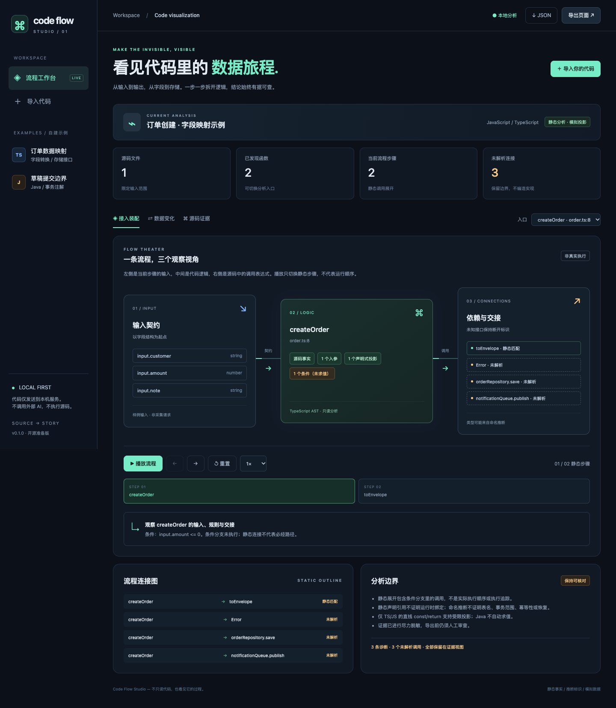
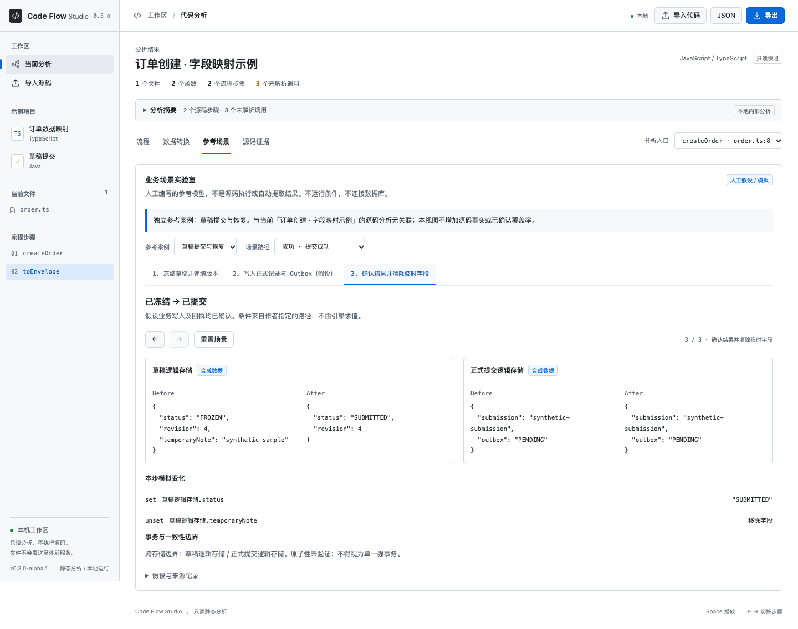
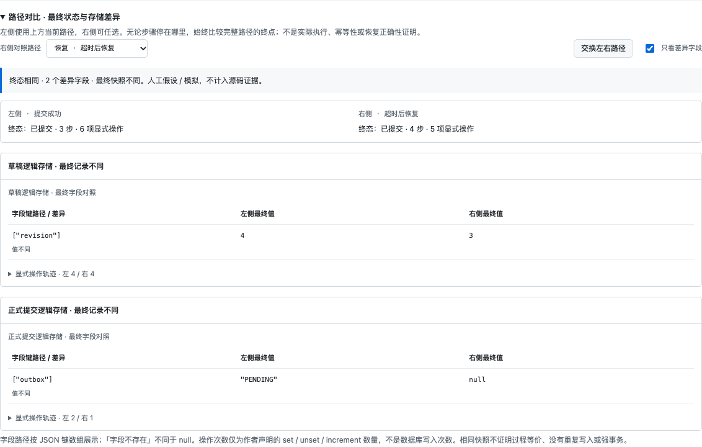

# Code Flow Studio

**让代码里的数据旅程，看得见。**

Local-first, evidence-backed visualization for Java, JavaScript and TypeScript. Upload source, explore a static flow outline, inspect field mappings, and export a standalone interactive page.

> v0.3.0-alpha.2 在独立参考场景实验室新增路径终点对比：并列核对最终状态、字段差异及显式操作轨迹，避免把相同终态误当成恢复正确或过程等价。场景为人工编写的公开合成案例，不从上传源码自动生成。默认仍导出无源码正文的评审版；静态分析不是实际执行，未知行为不补造。



## 功能

- **导入代码**：多文件、文件夹、拖放或粘贴片段；也可通过 CLI 分析本地模块。
- **入口选择**：发现函数与方法，按选定入口展开有限静态调用关系。
- **流程工作台**：输入契约 → 当前逻辑 → 依赖交接；侧栏定位文件与步骤，支持逐步播放、速度和重置。
- **数据工作台**：编辑演示 JSON，观察支持的 copy / rename / literal / object / array 投影。
- **字段血缘与差异**：追溯局部 const 别名，比较输入与输出对象的形态。
- **源码证据**：相对路径、原始行号、SHA-256、尽力脱敏的代码摘录与诊断。
- **可信度摘要**：区分源码事实、静态匹配、推断节点、未知关系与限制项，不用未知项填高覆盖率。
- **分级导出**：完整内部版、脱敏评审版、业务演示版；JSON 与单文件 HTML 使用同一策略，下载前确认清单及风险。
- **参考场景**：草稿提交与订单消息两类合成案例，分别包含成功、拒绝、失败和恢复路径；逐步查看状态与存储 Before/After。
- **路径对比**：任选两条参考路径，核对最终状态、嵌套字段和存储操作轨迹；区分缺失与 null，支持只看差异、左右交换和离线使用。
- **本地优先**：不调用外部 AI、不执行源码、不连接业务数据库。

## 快速开始

需要 **Node.js 22+**。

```bash
git clone https://github.com/CCdddbb/code-flow-studio.git
cd code-flow-studio
npm ci
npm start
```

打开 **http://127.0.0.1:4174**。页面默认展示订单合成示例；左侧可切换 Java 草稿示例，或点击「导入你的代码」。

端口占用时：

```bash
PORT=4180 npm start
```

PowerShell：`$env:PORT=4180; npm start`。

### 体验数据变化

1. 在订单示例中点击「下一步」，选择 `toEnvelope`。
2. 切到「数据转换」，修改 `input.customer` 或 `input.amount`，点击「应用修改」。
3. 核对返回对象、字段血缘、结构差异与源码证据。
4. 点击「导出页面」，选择导出级别，核对清单并确认风险后下载独立 HTML。

默认评审版不包含转换、条件和字面量，因此不重算数据投影。需要保留本机工作台的源码与投影时，主动选择「完整内部版」。

每个步骤独立使用自己的演示入参；系统**不假装自动执行调用链或传递真实运行值**。

### 体验参考场景

1. 切到「参考场景」，选择「草稿提交与恢复」。
2. 查看成功路径中的版本递增与临时字段移除，再切换「版本冲突」「回执超时」「超时后恢复」。
3. 点击步骤，核对状态变化、存储快照与明确标出的非原子边界。
4. 展开「路径对比」，左侧使用当前路径，右侧任选；默认对照成功与恢复。比较的是整条路径的终点，不随当前步骤位置变化。
5. 观察草稿成功/恢复：终态相同，但 `revision` 和 `outbox` 不同；展开操作轨迹核对差异来源。它说明参考模型需要评审，不证明真实系统存在相同问题。
6. 切换「订单与消息交付」，成功/恢复的最终记录相同但步骤不同；相同快照不证明幂等性或事务原子性。



这些案例**与当前分析项目无关联**，不影响质量计数。条件由作者指定而非执行，事务均标记未验证，数据全部为合成值。HTML 内置相同公开案例；分析 JSON 不包含它们，暂不支持自定义场景导入、编辑或源码关联。详见 [v0.3 第一阶段报告](docs/09-v03-scenario-lab.md)。



路径对比仅消费内置公开模型，不把结果或临时选择加入分析 JSON。详见 [路径对比迭代报告](docs/10-v03-path-comparison.md)。

## 命令行生成

```bash
npm run analyze -- fixtures/typescript --out artifacts/v02-order --mode review --acknowledge-risk
npm run analyze -- fixtures/java --entry DraftService.submit --out artifacts/v02-business --mode business --acknowledge-risk
npm run analyze -- /path/to/module --entry MyService.submit --out /path/to/new-output --mode internal --acknowledge-risk
```

输出：

```text
index.html      # 独立交互页面，双击可打开
analysis.json   # 当前级别的模型（review/business 为 share-1.0.0）
report.json     # 质量计数与固定边界说明，不夹带原始诊断
manifest.json   # 导出级别、包含/移除清单与风险
```

`--entry` 支持符号名或唯一 ID；同名入口须使用 ID。`--name` 可指定展示名称。输出目录必须在源码目录之外且为空；拒绝覆盖旧包，防止旧源码文件残留。CLI 先打印内容清单；所有级别均需传 `--acknowledge-risk` 确认权限与风险，不传时只显示清单并退出。分析不运行输入工程的构建/安装脚本。

### 证据是否陈旧

```bash
npm run evidence -- fixtures/typescript artifacts/v02-order/analysis.json
```

返回 `valid` / `stale` / `missing`；陈旧或缺失时退出码为 1。校验不会修改源码或静默更新证据。源码变更后需要重新分析。内部版与评审版可核验；业务版不含文件与证据元数据，不能核验。

### 三种分享级别

| 级别 | 保留 | 删除 |
| --- | --- | --- |
| 完整内部版 | 原分析模型、源码证据、投影与诊断 | 无；尽力脱敏不能保证无秘密 |
| 脱敏评审版（默认） | 流程、字段、相对文件位置、SHA-256 摘要、质量计数 | 源码正文、条件/转换、字面量、原始诊断及自由文本 |
| 业务演示版 | 流程、字段结构、依据标识、质量计数 | 进一步删除文件路径、行号、源码摘要 |

无源码模式通过独立 Schema 与字段白名单重建，不只是隐藏页面源码。分享包不包含临时编辑输入；离线页只能重新导出原始快照及当前级别，不能恢复被移除的信息。文件名、符号名及字段名仍可能敏感，三种模式均需授权与人工审查。真实项目的状态和人工确认说明尚未接入分析模型，不补造业务解释。HTML 中的参考场景是应用内置的独立合成案例，不属于被分析源码，也不包含临时输入。

## 支持范围

| 能力 | v0.3.0-alpha.2（本机内部分析） |
| --- | --- |
| JS/TS 解析 | TypeScript AST；函数、方法、接口/类型字面量、调用表达式、if 条件 |
| JS/TS 引用解析 | 同文件可见命名函数、this 方法、相对路径显式命名导入 |
| Java 解析 | 有限词法适配；public/protected/private 方法、字段、简单 record、注解线索 |
| Java 引用解析 | 简单字段声明类型的唯一方法匹配；**不证明 Spring 运行时绑定** |
| 自动样例 | 已发现字段的类型占位值；未知类型需手工补充 |
| 受限模拟 | JS/TS 直线 const/return 的对象、数组、引用、字面量投影 |
| 条件/重试/事务 | 展示条件与注解，不执行分支，不证明恢复/幂等/事务传播 |
| 数据库存储 | 调用命名提示，标记 inferred；**不生成真实表结构或持久化快照** |
| 参考场景实验室 | 独立合成场景；状态、set/unset/increment、逻辑快照与路径终点对比，**不自动提取业务场景或验证恢复正确性** |
| 整仓库/其他语言 | 尚未支持；推荐限定模块与入口 |

调用图是**静态展开**，包含条件内的调用；播放顺序不是执行顺序。复杂控制流、有副作用语句、未知计算会阻断后续模拟或返回 `$unknown`。unknown 不等于 null、失败、空表或回滚。

Java 示例刻意保留外部接口，不能编译或代表完整业务应用；它用于检验分析边界。所有公开示例为本项目新写的合成代码，未复制原业务仓库。

## 测试

```bash
npm run verify                 # 语法 + Schema + Node 单元/集成测试
npx playwright install chromium
npm run test:browser           # 真实浏览器回归（生成 artifacts/ 截图）
npm audit
```

macOS 有 Google Chrome 时自动使用；其他已有浏览器可通过 `CHROME_PATH` 指定。首次安装 Chromium 需要网络。

当前本地验收：**72 个 Node 测试 + 24 项浏览器检查通过**。包括路径对比的嵌套/缺失字段、确定性、轨迹、交换和空对象，以及原有 Schema、两案例四类路径、三种导出策略、源码泄漏哨兵、确认门禁、并发隔离、两种语言的离线对比及 390px 窄屏。详见 [路径对比迭代报告](docs/10-v03-path-comparison.md)。远程 CI 状态请查看 [GitHub Actions](https://github.com/CCdddbb/code-flow-studio/actions)，本地通过不等同于远程通过。

## 项目结构

```text
src/             分析器、解析适配、模型校验、本地服务、CLI、导出、证据核验
public/          通用装配台、数据工作台、纯投影引擎、响应式样式
schema/          JSON Schema v1
fixtures/        自建 Java / TypeScript 示例
tests/           Node 与 Playwright 回归
scripts/         语法检查
docs/            方案、实际模型说明、交付报告、公开截图
.github/         CI 与可手动启用的 Pages 演示部署
```

架构：`代码 → 静态事实/证据 → 校验模型 → 受限模拟 → 通用页面`。浏览器 UI 使用原生 ES Modules，无框架或远程 CDN；分析使用 TypeScript 与 Ajv。

- [更新日志与兼容性提示](CHANGELOG.md)
- [v0.3 路径对比与验收](docs/10-v03-path-comparison.md)
- [v0.3 参考场景实验室与验收](docs/09-v03-scenario-lab.md)
- [工作台 UI 重设计与开源参考](docs/08-ui-redesign.md)
- [v0.2 第一轮迭代设计与验收](docs/07-v02-iteration-report.md)
- [v0.1 历史模型与 API](docs/05-implementation.md)
- [产品迭代计划（v0.1.0 → v1.0）](docs/06-product-iteration-plan.md)
- [初始方案](docs/01-project-plan.md) / [契约草案](docs/02-analysis-contract.md) / [历史迭代路线](docs/03-iteration-backlog.md)
- [贡献指南](CONTRIBUTING.md) / [安全说明](SECURITY.md)

## 仓库与贡献

公开前确认没有私有源码、真实分析产物、密钥和连接配置。`node_modules/`、`artifacts/`、本地源码等已忽略。

```bash
git init -b main
git add .
git diff --cached --stat
# 人工审查暂存内容后：
git commit -m "Initial Code Flow Studio release"
git remote add origin https://github.com/YOUR_USERNAME/code-flow-studio.git
git push -u origin main
```

可选 GitHub Pages：在仓库 Settings → Pages 中选择 **GitHub Actions**，手动运行 `Publish synthetic demo to Pages`。它只发布自建订单示例的离线页；**Pages 不提供上传分析服务**，新代码分析仍需本地 `npm start`。

官方仓库：[CCdddbb/code-flow-studio](https://github.com/CCdddbb/code-flow-studio)。功能更新和兼容性变化记录在 [CHANGELOG.md](CHANGELOG.md)。分析产物不随源码提交；请勿将内部项目的导出包加入公开仓库。

## 后续方向

- 完整 Java AST/符号解析，更多框架适配。
- 带证据与人工确认的场景分支、状态机、事务/跨库投影。
- 可选模型辅助归纳及布局选择，保留本地无模型模式。
- 更多语言与独立业务基准，不把草稿示例硬编码成所有输入的答案。

## License

[MIT](LICENSE)。许可证仅覆盖本项目代码和自建示例；不授予用户输入源码的公开权利。
