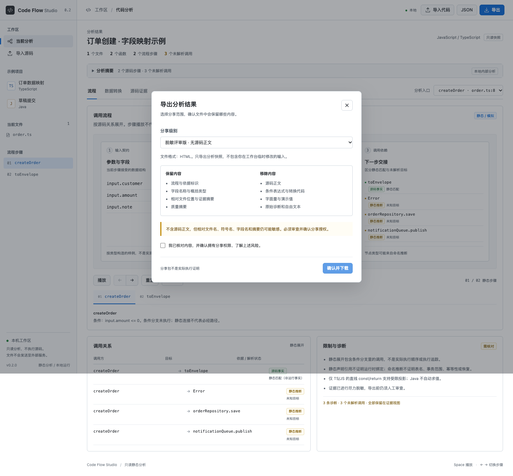

# 第一轮迭代：v0.2 可信交付与安全分享

- 依据：`06-product-iteration-plan.md` 的 v0.2 范围及第 10 节执行顺序。
- 日期：2026-10-15。
- 状态：本地实现和验收完成。本报告保留第一轮验收基线；后续 UI 与仓库更新见 [更新日志](../CHANGELOG.md)。
- 不包含：v0.3 场景/状态/持久化快照、Java AST 增强、项目历史和人工修订系统。

## 1. 本轮设计

### 1.1 用户任务

让用户在分享一次分析前知道：当前分析证明了什么、哪些仍未知，以及导出文件实际包含什么。优先解决隐藏源码泄漏，而不是增加动画或扩大解析范围。

### 1.2 质量摘要

`public/quality.js` 提供前后端共同使用的依据规范和统计函数：

- 源码事实步骤：仅指静态声明/表达式的源码依据，不证明运行时正确。
- 静态匹配关系：按流程中的 resolution 计数，分母是所有调用关系。
- 推断节点：节点类型来自命名等推断，独立显示。
- 未知关系：未解析调用不计入静态匹配，不叫“已确认覆盖率”。
- 限制项：固定分析限制，加上 warning/error 诊断数量。
- 源码步骤证据引用：单独显示引用完整性，不提供“可信度百分比”。

计数直接读取步骤、边、节点和证据，而不信任原 `report` 的覆盖字段。存在未知调用时，明确提示只适合局部源码核对，不能作为完整业务评审结论。

统一视觉：绿色=源码事实，橙色=静态推断，紫色=人工确认，虚线红色=未知，蓝色=模拟。颜色同时配文字。当前没有人工确认编辑功能，不制造已确认结论。

### 1.3 三种导出策略

| 策略 | 保留 | 删除 |
| --- | --- | --- |
| `internal` 完整内部版 | 原始分析模型、脱敏源码摘录、转换、条件、诊断 | 不额外删除；必须明确授权 |
| `review` 脱敏评审版（默认） | 流程、字段名称/概括类型、相对文件位置、证据摘要、质量计数 | 源码正文、条件/转换表达式、字面量、原始诊断、项目自由文本 |
| `business` 业务演示版 | 流程、字段结构、依据标识、质量计数 | 在 review 基础上进一步移除文件名、路径、行号和源码摘要 |

业务演示版只展示当前已经存在的流程与字段，不从没有模型的状态或说明中补造业务结论。状态变化与人工确认说明留给后续版本。

### 1.4 防泄漏机制

1. **白名单重建**：`src/sharing.js` 重新构造分享对象，不展开复制原分析对象。
2. **删除全部源码承载渠道**：不仅删除 excerpt，还删除 guards、transforms、原始诊断、自由文本、字面量类型与演示值。
3. **重新分配 ID**：分享 ID 不携带原始调用/证据对象中的自由字符串。
4. **符号与类型约束**：仅保留受限的符号名称和概括类型；不合法名称替换为占位标识。
5. **独立 Schema**：无源码包使用 `schema/share.schema.json`（`share-1.0.0`），不能冒充可完整核验的原分析模型。
6. **泄漏门禁**：生成后检查已识别令牌、连接信息、绝对路径及残余源码字段；不合法时阻断输出。
7. **全部格式同策略**：HTML 内嵌 JSON、独立 JSON 和质量报告均来自策略结果，不能只在页面隐藏源码。
8. **目录隔离**：拒绝向非空目录写出；排他导出锁防止两个策略并发混写。中断后残余锁需人工处理，建议改用新目录。

原始文件名、符号名、字段名及摘要仍可能敏感。此实现不承诺自动识别任何形式的秘密；无源码不等于获得公开授权。

### 1.5 确认与离线行为

- 页面 HTML 和 JSON 都先显示导出级别、包含/移除清单和风险，默认 review。
- 必须勾选分享权限与风险确认；切换级别会清除确认。
- 清单尚未载入时禁用确认控件，避免异步时序错误。
- API `/api/export` 要求 `confirmed: true`，仍保留本机 token 与同源门禁。
- CLI 先打印清单；所有模式要求 `--acknowledge-risk`，否则不导出。
- 离线页只允许重新下载当前级别的原始快照；不重新序列化用户修改后的 DOM，避免临时输入泄漏。
- 分享包不包含原始转换与字面量，因此**不提供数据投影重算**。内部版继续保留原功能。

## 2. 模块与契约变化

| 位置 | 变化 |
| --- | --- |
| `public/quality.js` | 依据标识、实际质量计数、用途建议、导出规格 |
| `public/app.js`、`public/index.html`、样式 | 质量面板、节点依据、导出确认、分享模式降级展示 |
| `src/sharing.js` | 白名单重建、共享 Schema/引用校验、泄漏阻断 |
| `schema/share.schema.json` | 无源码视图专用契约，禁止源码承载字段 |
| `src/export.js` | 分级 HTML/JSON/报告/manifest，拒绝旧目录残留及并发混写 |
| `src/server.js` | 清单预览、确认门禁、JSON/HTML 同策略输出 |
| `src/cli.js` | `--mode`、`--acknowledge-risk`、内容清单 |
| `src/evidence.js` | review 可凭摘要本地核验；business 明确拒绝核验 |
| CI/Pages | 合成示例显式确认风险，默认发布 review 而非内部源码包 |

原分析模型仍为 `1.0.0`；内部导出与原模型兼容。分享视图不是完整分析输入，不能提交它以恢复高披露级别。

### API

```text
POST /api/export/preview
{ model, mode?: "review" | "business" | "internal" }
→ 清单（不返回源码正文）

POST /api/export
{ model, mode?, format?: "html" | "json", confirmed: true }
→ 选定策略的文件内容
```

省略 mode 默认 review，省略 format 默认 HTML。未知模式/格式、缺少确认或非法模型会拒绝请求。

## 3. 运行与验收

### 已执行命令

```bash
npm run verify
npm run test:browser
npm audit
git diff --check
```

- 20 个 JS/CJS 文件及 JSON 检查通过。
- **50 个 Node 测试通过**，无失败/跳过（比基线新增 14 个）。
- **16 项真实浏览器检查通过**（比基线新增 4 项）。
- `npm audit`：锁定依赖当前 0 个已报告漏洞，不等于系统绝对无漏洞。
- `git diff --check`：通过。

环境：本地 Node.js 22.23.3、macOS、Google Chrome/Playwright。GitHub CI 配置已更新，但没有在远程实际执行。

### 验收门槛逐项对照

| 计划门槛 | 验证 |
| --- | --- |
| 无源码包不出现源码正文/绝对路径/令牌/连接串 | TS 与 Java 哨兵用例逐个检查 HTML、JSON、report、manifest；覆盖注释、条件、转换、字面量类型、项目名、诊断和异常 ID |
| 每个流程节点显示依据 | 节点清单、当前步骤和依赖卡片标识；浏览器核对节点数与图例 |
| 未解析连接不计入已确认覆盖率 | 订单样例静态匹配 1/4、未知 3；不显示已确认覆盖率；单测篡改 report 不影响计数 |
| 离线导出可打开且不访问外网 | TS/Java × internal/review/business 六个组合均经 file:// 打开，逐页捕获网络与脚本异常 |
| 安全、Schema、浏览器回归通过 | 原 36 个 Node/12 项浏览器基线保留，增加策略校验、确认门禁、并发隔离与安全再导出 |

### CLI 实跑产物

已分别生成 TS 和 Java 的三种导出，位于：

```text
artifacts/v02/typescript-review/
artifacts/v02/typescript-business/
artifacts/v02/typescript-internal/
artifacts/v02/java-review/
artifacts/v02/java-business/
artifacts/v02/java-internal/
```

每个目录包含 `index.html`、`analysis.json`、`report.json`、`manifest.json`。这些都是自建示例，默认不纳入 Git。

实跑命令示例（输出目录必须为空或不存在）：

```bash
npm run analyze -- fixtures/typescript --mode review --acknowledge-risk --out artifacts/new-review
npm run analyze -- fixtures/java --mode business --acknowledge-risk --out artifacts/new-business
npm run analyze -- fixtures/java --mode internal --acknowledge-risk --out artifacts/new-internal
npm run evidence -- fixtures/typescript artifacts/v02/typescript-review/analysis.json
```

评审版 TS 和内部版 Java 证据核验均为 valid。business 不含证据元数据，拒绝核验而非显示假通过。

### 本机常驻服务验证

已重启本项目服务，`http://127.0.0.1:4174` 的运行版本为 v0.2.0。现场冒烟验证通过：清单预览 200、未确认导出被拒绝、business JSON 无源码元数据、浏览器默认 review 且未勾选时禁用下载。记录在 `artifacts/v02-live-smoke.json`。



### 本轮发现并修正

- 分享 Schema 严格校验要求显式定义 quality 属性：已补齐并禁止额外属性。
- 清单异步载入期间确认可能失效：改为载入完成才启用复选框。
- DOM 重新导出可能夹带用户临时输入：改为重新下载原始离线快照。
- 旧目录可能残留高披露文件、并发策略可能混写：空目录门禁 + 排他锁。
- `git diff --check` 发现 CSS 尾部空行：已修正。

## 4. 下一轮边界

按路线进入 v0.3 前，应先定义带证据或人工来源的场景、状态与持久化变化模型，再接入草稿标杆和第二个独立案例。当前版本没有自动恢复原 Demo 的跨库电影，也不把词法分析、静态匹配或模动画面宣称为真实执行。
